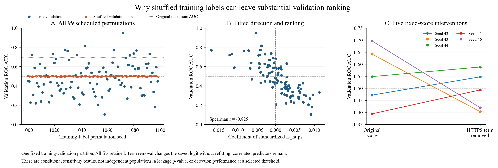

# Why randomized training labels can retain validation ranking

The audited controls' high AUC has a reproducible computational explanation.
Small random fitted directions act on a validation set whose URL format remains
strongly associated with class. AUC measures the resulting order, not distance
from probability 0.5. The evidence identifies a substantial HTTPS contribution
and reproduces broad variation across the full scheduled randomization set.

## Input and score checks

The audit verifies the two partition hashes, train–validation separation by
registrable domain, record identity and canonical URL, the actual shuffled labels
consumed by each of the five original P fits, training-only scaling, saved
coefficients and reconstructed validation scores. It reproduces the published
AUC/AP within 1e-12. The five controls retain their original Table 4.24 results;
threshold-selected TP/FP counts remain descriptive validation outcomes.

There are 166,248 training rows and 32,695 validation rows. Every one of the
20,209 validation negatives is HTTPS, compared with 5,823 of 12,486 positives
(46.6362%). Negative HTTPS status alone gives AUC 0.7668188371. Training-label
permutation leaves this validation association intact. A single fitted coefficient
vector orders every validation row, so the rows are not independent random
score assignments. The five controls' coefficient norms are 0.0299–0.0851;
their central probability halves lie within approximately 0.4977–0.5024.
Multiplying nonconstant logits by a positive constant preserves their rank.

## Fixed-score intervention

Removing only the standardized HTTPS term from the saved logit gives:

| Seed | Original AUC | AUC without HTTPS term | HTTPS coefficient |
|---|---:|---:|---:|
| 42 | 0.471800 | 0.547616 | +0.001475 |
| 43 | 0.641862 | 0.403083 | −0.008797 |
| 44 | 0.548674 | 0.588349 | +0.000958 |
| 45 | 0.394005 | 0.493353 | +0.004024 |
| 46 | 0.696523 | 0.419535 | −0.009530 |

This calculation changes one explicit contribution while holding every other
coefficient fixed. It is neither retraining nor a causal importance estimate.
Correlated predictors retain other scheme information. All five controls appear,
including the cases where term removal moves AUC further from 0.5.

## Complete randomization experiment

The frozen protocol specifies PCG64 training-label seeds 1000–1098, fixed input
rows and scaling, and L1 logistic regression with C=1, balanced class weights,
SAGA solver seed 42, tolerance 1e-4 and 5,000 maximum iterations. All 99 attempts
complete without warnings, in 260–3458 iterations.
No threshold is selected. No seed is substituted or dropped.

| Summary | True validation labels | Independently shuffled validation labels |
|---|---:|---:|
| Mean AUC | 0.477889 | 0.500021 |
| Median | 0.447892 | 0.500016 |
| Minimum | 0.104583 | 0.493314 |
| Maximum | 0.949560 | 0.506633 |
| Empirical 2.5th percentile | 0.206092 | 0.494884 |
| Empirical 97.5th percentile | 0.771793 | 0.505884 |

12 of 99 reach or exceed 0.696523, the largest
original audited AUC. That frequency describes conditional algorithmic
sensitivity on these fixed data; it is not a leakage p-value or an estimate of
independent-population generalization. Validation-label permutations use seed
210000 plus the training-label seed. Constant-score AUC equals 0.5.

The HTTPS coefficient and true-label AUC have descriptive Spearman correlation
-0.825343. Removing that term changes mean absolute
AUC departure from 0.5 from 0.142361 to
0.085120. With equal total weight per
validation domain, AUC still spans 0.076963–
0.955417. Repeated rows within domains are
insufficient to account for the spread, although domain weighting does not
establish campaign independence.

[Vector PDF figure](shuffled-label-mechanism.pdf).

## Numerical convergence

A separate frozen check warm-starts each original fitted state with tolerance
1e-7 and maximum 20,000 iterations, keeping its labels, objective and solver seed.
All five finish without warnings. The largest absolute AUC change is
0.000406361. The highest original control moves from
0.696523 to 0.696632. The largest first-order residual is
3.4825e-09 after division by total sample weight, for
weighted logistic loss plus the L1 penalty and an unpenalized intercept.
The original stopping tolerance is inadequate to explain the wide ranking spread.

## What follows

These checks jointly explain how the audited estimator produces the anomalous
ranking: randomized labels leave small coefficients; fixed validation labels
retain format structure; and rank metrics preserve its ordering effect. They do
not uniquely attribute every feature contribution, explain the origin of the
collection convention, authenticate older fits without input receipts, or prove
absence of all leakage. Evaluation should examine fitted state, randomization
units, score ordering and operating-point errors together.

The original five controls, the 99 training-label permutations and the five
optimization continuations answer different questions. Their protocols preserve
that distinction. These analyses use only the training and validation partitions;
no external or group-test records are accessed. See [reproduction](../REPRODUCTION.md).
